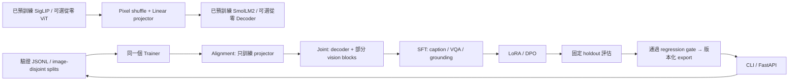

# simple-vlm — nanoVLM v0.1 Laptop Lab

這是一套位於 `C:\LLM\VLM_base` 的可執行教學 VLM repo。以
[huggingface/nanoVLM v0.1](https://github.com/huggingface/nanoVLM/tree/v0.1)
固定 commit `6ba9082e16f1fc8c21a1f8d0c54b26c9233c8771` 的原生 PyTorch
ViT 與 GQA/RoPE/SwiGLU decoder 為基礎，保留 pixel shuffle projector 與 image-prefix
設計。新增的各階段 **共用 `training/trainer.py`，沒有七套訓練 loop**。

主要路線：**預訓練 SigLIP + SmolLM2 → 隨機 projector alignment → 漸進聯合訓練
→ 多任務 SFT → LoRA → DPO → 評估 → 推理/部署**。Vision/LLM 從零預訓練是另一條
可選的教學路線；Laptop 不需要重新訓練這兩個骨幹。

## 四個系統與 13 個 Phase

| 系統 | 所屬 Phase | 實作 |
|---|---|---|
| Model | 2 Vision、3 Decoder、4 Alignment、5 Joint 的模型組件 | `models/`、`tokenization/` |
| Data | 1 Raw preparation，以及 6/7/8 所需的 task/preference 資料 | `scripts/prepare_data.py`、`datasets/`、`data/` |
| Training | 2–8 的 train/freeze/loss 策略；11 checkpoint/experiment；13 retraining | 一個 `Trainer`、`training/stages/`、`scripts/promote.py` |
| Evaluation/Inference | 9 Evaluation、10 Inference、12 Deployment，以及 13 的 regression gate | `evaluation/`、`inference/`、`serving/` |



## 已完成的能力與範圍

- 預訓練 SigLIP-B/16-224、SmolLM2-135M 的原始權重載入；projector 隨機初始化。
- Tiny 離線模型使用相同骨幹程式與 UTF-8 byte tokenizer，不會下載模型。
- Answer-only causal loss；image、prompt、padding 不列入 targets，shift 只執行一次。
- Frozen backbone、最後 N 個 blocks 漸進解凍、component learning rates、gradient
  accumulation、clipping、FP32/BF16/FP16、gradient checkpointing。
- LoRA 注入原生線性層，可合併後匯出；DPO 使用固定 reference、completion log-prob
  **sum**，reference 一併存入續訓 checkpoint。
- JSONL 驗證、去重、依影像內容與 `group_id` 分割、防止同影像出現在 train/val。
- Caption、VQA、grounding、image-text、text、image classification、preference adapters。
- 原子 checkpoint、optimizer/scaler/scheduler/RNG/epoch/batch cursor 還原；固定
  Hub revisions、tokenizer fingerprint、資料/影像 hashes、run metadata、metrics。
- Teacher-forced loss/perplexity、caption ROUGE-L、VQA normalized exact match、grounding
  IoU/precision/recall、yes/no object-presence probe；生成與預測逐筆留存。
- CLI 推理、grounding parser/畫框、獨立離線 export、FastAPI、CPU Dockerfile、promotion gate。

這是可運作的研究/教學基底，不是已訓練好的通用 VLM。Demo 資料的幾步訓練只檢查
工程流程。Caption 指標不是 COCO CIDEr，VQA exact match 不是官方 VQAv2 evaluator，
presence probe 不是完整 POPE benchmark；正式研究應加入對應 benchmark 的官方 evaluator。
Vision pretrain 提供 supervised classification，**不是重現大規模 SigLIP contrastive pretraining**。
PaliGemma-style 只指任務提示與座標輸出表示；注意力仍是 nanoVLM 的 causal prefix。
`<segXXX>` 預留 vocabulary，沒有 segmentation VQ codebook/mask decoder。

## Windows / Laptop 安裝

目前這台機器偵測為 **RTX 4000 Ada Laptop，12GB VRAM，支援 BF16**。
使用 Python 3.10+，建議 3.12。已建立本地 `.venv`；新電腦可執行：

```powershell
Set-Location C:\LLM\VLM_base
py -3.12 -m venv .venv
# 不必修改 PowerShell execution policy，直接使用 venv 的 python。
& .\.venv\Scripts\python.exe -m pip install torch==2.6.0 --index-url https://download.pytorch.org/whl/cu124
& .\.venv\Scripts\python.exe -m pip install -r requirements.txt
& .\.venv\Scripts\python.exe -m scripts.doctor
```

沒有 NVIDIA GPU 時，第一條安裝命令改成 `--index-url https://download.pytorch.org/whl/cpu`。
CPU 訓練請將 training YAML 的 `precision` 設為 `fp32`。不需要 flash-attn、bitsandbytes、
wandb 或 Linux。Windows DataLoader 固定 `num_workers=0`，先保持可讀與可重現。

Hugging Face cache 預設在專案 `.cache/huggingface`。模型 YAML 已固定三個 Hub commit，
首次下載需要網路；已有 cache 後可設定 `$env:HF_HUB_OFFLINE='1'`。
`--resume`、`--init-from` 和匯出模型推理會使用 checkpoint 隨附的 tokenizer，完全不必再下載骨幹。
未固定 revision 的自訂設定會在首次建立時解析成 SHA，再記入 checkpoint。
`requirements-windows-cu124.lock.txt` 保存這台機器已驗證的完整 Windows/CUDA 套件版本；
先安裝對應 CUDA torch 後，可用它重建相同依賴。CPU 安裝使用一般 `requirements.txt`。

## 先跑完整工程流程

```powershell
& .\.venv\Scripts\python.exe -m scripts.smoke --device cpu --output artifacts/runs/my-smoke-cpu
& .\.venv\Scripts\python.exe -m scripts.smoke --device cuda --precision bf16 --output artifacts/runs/my-smoke-cuda
& .\.venv\Scripts\python.exe -m pytest --basetemp=artifacts/test-temp-local
```

Smoke 在 synthetic rectangles 上，依序實際訓練 vision、decoder、alignment、joint、SFT、
LoRA、DPO，再評估與匯出。每個 stage 都呼叫同一個 Trainer，每個 3 optimizer steps。
選擇新的 output 目錄保留每次實驗；檢查該目錄的 `smoke_report.json`。
`tests/` 會驗證 causal mask、answer boundary、凍結梯度、LoRA merge、DPO reference、
資料洩漏、API 與 resume；包含跨 epoch、最後不足 accumulation 的 batch 與 dropout RNG。
已下載骨幹後，亦可使用 `$env:HF_HUB_OFFLINE='1'` 搭配
`python -m scripts.check_backbones`，核對 native 與 Transformers 的 FP32 輸出。
本機實際驗證摘要見 `VALIDATION.md`；設計契約見 `docs/architecture.md`。

## 資料格式與準備

影像路徑相對於 `--root`，預設 repo 根目錄。UTF-8 JSONL 每行一筆，推薦帶穩定的 `id`。

```jsonl
{"id":"c1","task":"caption","image":"data/raw/images/001.jpg","caption":"A red car on the road."}
{"id":"v1","task":"vqa","image":"data/raw/images/002.jpg","question":"What color is the car?","answer":"red"}
{"id":"g1","task":"grounding","image":"data/raw/images/003.jpg","query":"car","objects":[{"label":"car","bbox":[0.1,0.2,0.8,0.9]}]}
{"id":"p1","task":"preference","image":"data/raw/images/004.jpg","prompt":"answer What color is the car?","chosen":"red","rejected":"blue"}
{"id":"t1","task":"text","text":"A short text for random decoder pretraining."}
{"id":"i1","task":"image","image":"data/raw/images/005.jpg","label":0}
```

`bbox` 輸入為完整原圖的 **normalized `[x0,y0,x1,y1]`**，值在 [0,1] 且有正面積。
轉成 `<locYYYY><locXXXX><locYYYY><locXXXX> label`，1024 bins、y0/x0/y1/x1 順序，
解碼時除以 1024。邊界 1.0 截至 bin 1023，存在最多約一個 bin 的量化誤差。
影像採整張 resize、沒有 crop，因此 normalized bbox 不需重新裁切。
詳見 [PaliGemma 輸出格式](https://huggingface.co/blog/paligemma)。

```powershell
& .\.venv\Scripts\python.exe -m scripts.prepare_data --input data/annotations/caption.jsonl --output data/manifests/alignment
& .\.venv\Scripts\python.exe -m scripts.prepare_data --input data/annotations/caption.jsonl data/annotations/vqa.jsonl --output data/manifests/multimodal_pretrain
& .\.venv\Scripts\python.exe -m scripts.prepare_data --input data/annotations/caption.jsonl data/annotations/vqa.jsonl data/annotations/grounding.jsonl --output data/manifests/sft
& .\.venv\Scripts\python.exe -m scripts.prepare_data --input data/annotations/preference.jsonl --output data/manifests/dpo
```

準備器會驗證影像可讀、拒絕越出 dataset root 的路徑、記錄 SHA256、去除相同内容。
同影像即使不同檔名，也會留在同一 split。可加入 `group_id`，讓相同文件/來源/個體的
多張影像一起分割。至少需要兩個獨立 group。各命令分別產生 `train.jsonl`、`val.jsonl`、
`manifest.json`。**跨階段也要保留固定 evaluation holdout**，不要將 SFT/DPO 的同一
evaluation image 混回訓練；prepare 的單次分割只保證該次輸入內的隔離。

資料與 tokens 超過 `max_length` 時明確報錯，不會默默截掉整個 answer。
可提高配置或分割資料。這個版本使用記憶體內的 local JSONL；大量資料應先 sharding，
目前沒有 streaming/WebDataset、多影像對話、影片或混合 text-only/image 的 batch。

## 主要訓練路線

以下命令使用真實預訓練骨幹，資料路徑來自對應 training YAML，`max_steps` 是 optimizer
steps。Batch 1 × accumulation 8 的有效 batch 約為 8（epoch 最後一組可能較小）。

```powershell
# Phase 4: 新 projector；vision 和 decoder 的參數完全 frozen。
& .\.venv\Scripts\python.exe -m scripts.train --training configs/training/alignment.yaml --output artifacts/runs/alignment-v001

# Phase 5: 繼承 projector，decoder 聯合訓練；預設解凍 vision 最後 2 個 blocks。
& .\.venv\Scripts\python.exe -m scripts.train --training configs/training/multimodal_pretrain.yaml --init-from artifacts/runs/alignment-v001/last.pt --output artifacts/runs/joint-v001

# Phase 6: 加入 1024 loc + 128 seg tokens，擴大 embedding/head，開始學習空間輸出。
& .\.venv\Scripts\python.exe -m scripts.train --training configs/training/sft.yaml --init-from artifacts/runs/joint-v001/last.pt --enable-spatial-tokens --output artifacts/runs/sft-v001

# Phase 7: 自訂領域資料 --data；vision frozen，decoder 只學 q/v LoRA，projector 可訓練。
& .\.venv\Scripts\python.exe -m scripts.train --training configs/training/lora.yaml --data data/manifests/sft/train.jsonl --init-from artifacts/runs/sft-v001/last.pt --output artifacts/runs/domain-v001

# Phase 8: 完全相同 image/prompt 的 chosen/rejected；固定起始 reference。
& .\.venv\Scripts\python.exe -m scripts.train --training configs/training/dpo.yaml --init-from artifacts/runs/domain-v001/last.pt --output artifacts/runs/dpo-v001
```

初始模型預設 `configs/model/pretrained_vlm.yaml`。只有第一階段需要它；`--init-from`
以來源 checkpoint 的模型與 tokenizer 為準，並先合併舊 LoRA，再依新階段加上新 LoRA。
SFT 的 `train_embeddings: true` 讓新增 loc tokens 能學習，alignment 強制只學 projector。
LoRA 凍結既有 spatial embeddings；若新領域需重新學空間語意，可自行啟用
`train_embeddings: true`，這會訓練整個 embedding/head matrix，不能視為純 adapter 訓練。
DPO reference 包含 image conditioning，會增加權重記憶體与 checkpoint 大小。

修改 YAML 的 `vision_unfreeze_last`、`decoder_unfreeze_last` 可逐步解凍。
`0` 為全部 frozen；設定 `decoder_unfreeze_last` 會覆蓋 decoder/embedding 的預設解凍策略，
一般 LoRA/DPO 不應設定它。若要訓練全部 vision blocks，可移除 `vision_unfreeze_last`。

## 續訓與 checkpoint

```powershell
& .\.venv\Scripts\python.exe -m scripts.train --training configs/training/alignment.yaml --resume artifacts/runs/alignment-v001/last.pt --output artifacts/runs/alignment-v001
```

`--resume` 要求 training config、manifest、影像 bytes、device type 相同；保留既定 LR schedule，
恢復 optimizer/scaler/scheduler、Python/Torch/CUDA RNG、epoch 與下一個 batch。
想增加 steps、改資料、換 device、切 stage 時，使用 `--init-from` 與新的 output。
可用 `--stop-after N` 測試中斷，它不會改掉 config 的 `max_steps`。
CPU deterministic 測試會要求逐 tensor 完全一致；跨 CUDA 環境/版本不承諾 bitwise 一致。
Ctrl+C 尚未到 checkpoint 的部分會遺失，恢復到最近完成的 optimizer-step snapshot。

每個 run 會產生：

```text
run.json                 # effective config、資料 hashes、Hub SHAs、套件/Git/上游版本
resume.json              # 最近一次續訓 metadata
metrics.jsonl            # optimizer-step loss、LR、VRAM、preference accuracy
last.pt                  # 完整續訓 state，原子 replace
step-000100.pt            # 保留的版本；同磁碟可用 hardlink，否則 copy
tokenizer/               # 完整匹配模型的 tokenizer
```

所有 `step-*` 都會保留，因此長實驗需自行管理磁碟容量。Checkpoint 不包含原始影像。
不要單獨移動 `.pt` 而遺失同目錄的 tokenizer；匯出整個 bundle 才可移到別台電腦。

## 可選：兩個骨幹從零訓練

```powershell
& .\.venv\Scripts\python.exe -m scripts.make_demo_data
& .\.venv\Scripts\python.exe -m scripts.train --model configs/model/tiny_vlm.yaml --training configs/training/vision_pretrain.yaml --data data/manifests/demo/image/train.jsonl --output artifacts/runs/random-vision
& .\.venv\Scripts\python.exe -m scripts.train --model configs/model/tiny_vlm.yaml --training configs/training/llm_pretrain.yaml --data data/manifests/demo/text/train.jsonl --output artifacts/runs/random-decoder
& .\.venv\Scripts\python.exe -m scripts.train --model configs/model/tiny_vlm.yaml --training configs/training/alignment.yaml --data data/manifests/demo/alignment/train.jsonl --vision-from artifacts/runs/random-vision/last.pt --decoder-from artifacts/runs/random-decoder/last.pt --output artifacts/runs/random-alignment
```

此路線只適合了解 pretraining；從零訓練能辨識實際世界的模型需要足夠資料與算力。
`tokenization/train_tokenizer.py` 可為 random decoder 訓練 BPE，範例：

```powershell
& .\.venv\Scripts\python.exe -m tokenization.train_tokenizer --text data/raw/text/corpus.txt --output data/processed/tokenizer --vocab-size 8192
```

搭配自訂模型 YAML：`vlm_load_backbone_weights: false`、`tokenizer_backend: hf`、
`lm_tokenizer: data/processed/tokenizer`。Vocabulary 自動同步到 tokenizer 大小。
**不可換掉預訓練 SmolLM2 的 tokenizer**，否則 token IDs 與 embedding 語意會錯位。

## 評估、推理與部署

```powershell
& .\.venv\Scripts\python.exe -m scripts.evaluate --checkpoint artifacts/runs/sft-v001/last.pt --data data/manifests/sft/val.jsonl --output artifacts/metrics/sft-v001
& .\.venv\Scripts\python.exe -m scripts.evaluate --checkpoint artifacts/runs/dpo-v001/last.pt --data data/manifests/sft/val.jsonl --output artifacts/metrics/dpo-v001
& .\.venv\Scripts\python.exe -m scripts.evaluate --compare artifacts/metrics/sft-v001/report.json artifacts/metrics/dpo-v001/report.json
& .\.venv\Scripts\python.exe -m scripts.infer --checkpoint artifacts/runs/sft-v001/last.pt --image data/raw/images/003.jpg --prompt "detect car" --draw artifacts/metrics/car.png
& .\.venv\Scripts\python.exe -m scripts.export --checkpoint artifacts/runs/dpo-v001/last.pt --output artifacts/releases/v001

$env:VLM_CHECKPOINT = 'C:\LLM\VLM_base\artifacts\releases\v001\model.pt'
& .\.venv\Scripts\python.exe -m uvicorn serving.api:create_app --factory --host 127.0.0.1 --port 8000 --workers 1
```

`http://127.0.0.1:8000/docs` 可上傳 image 與 prompt，`/health` 回報裝置。
使用一個 worker，request 會序列化，避免重複模型與 VRAM 峰值。這是本機 API，尚未加入
公網服務需要的認證/限流/觀測。上傳只收 image bytes，大小上限 10 MiB。

推理預設 greedy；`configs/inference.yaml` 可調 temperature/top_k/budget。
一次一張 image，vision prefix 只計算一次；沒有 KV cache、beam search 或批次生成。
`--presence-probe` 評估需提供 yes/no object-presence VQA 資料。
比較 checkpoint 時要求相同 manifest、影像內容与生成設定。

Docker CPU 部署（尚需自行在有 Docker 的環境建置）：

```powershell
docker build -f serving/Dockerfile -t simple-vlm .
docker run --rm -p 127.0.0.1:8000:8000 -v C:/LLM/VLM_base/artifacts/releases/v001:/model:ro simple-vlm
```

## Continuous improvement / retraining

1. 將新領域標註、修正回答、chosen/rejected 加入新版本 annotations，保留固定 holdout。
2. Prepare 新版本 manifests，以 `--init-from` 執行 SFT/LoRA/DPO，output 使用新 run ID。
3. 在同一 holdout 分別評估 baseline 與 candidate，人工檢查 `predictions.jsonl` 的失敗類型。
4. 依實際 benchmark 修改 `configs/promotion.yaml`，通過門檻後才產生新 release。

```powershell
& .\.venv\Scripts\python.exe -m scripts.promote --baseline-report artifacts/metrics/sft-v001/report.json --candidate-report artifacts/metrics/dpo-v001/report.json --checkpoint artifacts/runs/dpo-v001/last.pt --output artifacts/releases/v002
```

Gate 會核對候選 checkpoint hash、固定測試集與生成設定，拒絕缺失指標或超出容許退步。
通過後保存合併的權重、tokenizer、`artifact.json`、`release.json`；部署時切換
`VLM_CHECKPOINT` 並重啟 API，可再切回舊 release。這個 repo 不會自動抓資料或啟動定時訓練。

## 建議閱讀順序與來源

先讀 `models/projector.py` → `models/vlm.py` → `datasets/collator.py` →
`training/trainer.py` → `training/stages/`，最後深入上游 `vision_transformer.py` 与
`language_model.py`。前者薄而可讀；骨幹保留 nanoVLM 的教育實作，並加上 strict loading、
Hub revision 與可攜的 SDPA mask。

`vendor/nanovlm_v01/` 保留固定版本的上游核心/訓練/README 原文供 diff；
`UPSTREAM.md` 記錄 SHA256、來源與本地修改。這裡的 training checkpoint 有自己的
格式，並非直接相容上游 nanoVLM-222M 的 `model.safetensors` VLM checkpoint。
骨幹權重則由原 v0.1 mapping 載入，新的 inference bundle 可以完全離線。

參考：[nanoVLM v0.1 release](https://github.com/huggingface/nanoVLM/releases/tag/v0.1)、
[SigLIP](https://huggingface.co/google/siglip-base-patch16-224)、
[SmolLM2](https://huggingface.co/HuggingFaceTB/SmolLM2-135M)、
[PaliGemma spatial outputs](https://huggingface.co/blog/paligemma)。
